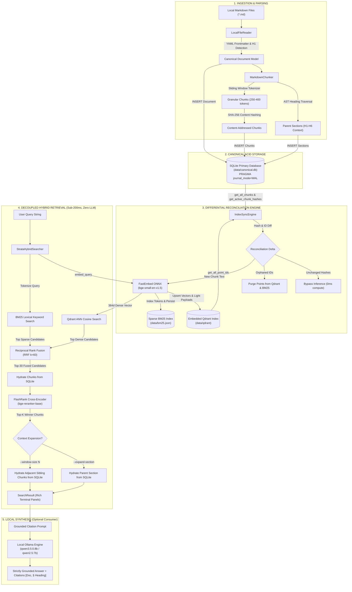

# ⚡ Strata

> **100% Offline, Air-Gapped Personal Knowledge Engine & Local Hybrid RAG Architecture**

<p align="center">
  <a href="https://www.python.org/downloads/"></a>
  <a href="https://github.com/astral-sh/uv"></a>
  <a href="https://www.sqlite.org/"></a>
  <a href="https://qdrant.tech/"></a>
  <a href="https://github.com/dorianbrown/rank_bm25"></a>
  <a href="https://github.com/qdrant/fastembed"></a>
  <a href="https://github.com/PrithivirajDamodaran/FlashRank"></a>
  <a href="https://ollama.ai/"></a>
  <a href="https://github.com/astral-sh/ruff"></a>
  <a href="https://mypy-lang.org/"></a>
  <a href="https://docs.pytest.org/"></a>
  <a href="LICENSE"></a>
</p>

---

## 📖 Overview

**Strata** is an air-gapped, privacy-preserving personal knowledge engine and hybrid retrieval-augmented generation (RAG) system built from first principles.

Most conventional RAG prototypes treat vector databases as primary data stores. When embedding models change, vectors get corrupted, or text is updated, these systems either fail or require expensive, full-collection re-embedding.

Strata solves this by enforcing an uncompromising architectural boundary:
* **SQLite is the Canonical Source of Truth:** Documents, structural Markdown sections, tokenized search chunks, and cryptographic hashes live exclusively in an ACID-compliant SQLite store.
* **Qdrant and BM25 are Ephemeral Derived Indices:** Both dense vectors (embedded Qdrant) and sparse inverted indices (BM25) are strictly disposable. If either index is deleted or wiped, running `strata sync` deterministically reconstructs them directly from SQLite.
* **Content-Addressable Differential Invalidation:** Every chunk is fingerprinted with a SHA-256 hash over its heading breadcrumb path and text body (`heading_path:text`). Unchanged chunks bypass embedding computation entirely ($0\text{ ms}$ overhead), while newly created chunks are incrementally embedded and orphaned chunks are purged.
* **Decoupled Sub-200ms Hybrid Search:** The search engine executes parallel dense semantic search, sparse lexical BM25 matching, Reciprocal Rank Fusion (RRF), and cross-encoder re-ranking in **under 200 ms without loading or invoking an LLM**.
* **Hierarchical Small-to-Big Retrieval:** Small child chunks (~350 tokens) are indexed for precise semantic matching, but automatically hydrate their parent section context (~900+ tokens) and adjacent sibling windows from SQLite prior to presentation or synthesis.

---

## 📑 Table of Contents

- [Overview](#-overview)
- [Key Features](#-key-features)
- [Architectural Blueprint](#-architectural-blueprint)
  - [End-to-End Workflow Diagram](#end-to-end-workflow-diagram)
  - [Workflow Deep-Dive](#workflow-deep-dive)
    - [1. Ingestion & AST Parsing](#1-ingestion--ast-parsing)
    - [2. Hierarchical Small-to-Big Chunking](#2-hierarchical-small-to-big-chunking)
    - [3. Differential Synchronization Engine](#3-differential-synchronization-engine)
    - [4. Decoupled Two-Stage Hybrid Retrieval](#4-decoupled-two-stage-hybrid-retrieval)
    - [5. Cross-Encoder Re-Ranking & Context Hydration](#5-cross-encoder-re-ranking--context-hydration)
- [Project Structure](#-project-structure)
- [Local Setup & Getting Started](#-local-setup--getting-started)
  - [Prerequisites](#prerequisites)
  - [Installation with uv](#installation-with-uv)
  - [Local LLM Configuration (Optional)](#local-llm-configuration-optional)
- [CLI Usage Guide](#-cli-usage-guide)
  - [1. Document Ingestion (`strata ingest` / `strata add`)](#1-document-ingestion-strata-ingest--strata-add)
  - [2. Differential Synchronization (`strata sync`)](#2-differential-synchronization-strata-sync)
  - [3. Sub-200ms Hybrid Search (`strata search`)](#3-sub-200ms-hybrid-search-strata-search)
  - [4. System Telemetry & Status (`strata status`)](#4-system-telemetry--status-strata-status)
- [Configuration Reference](#-configuration-reference)
- [Quality Assurance & Verification](#-quality-assurance--verification)
- [License](#-license)

---

## ✨ Key Features

| Capability | Implementation | Advantage |
|---|---|---|
| **Air-Gapped Privacy** | 100% Local (ONNX + SQLite + Embedded Qdrant + Ollama) | Zero cloud API calls, zero tracking telemetry, zero data leaks. |
| **Primary Data Integrity** | SQLite with WAL mode & cascading foreign keys | Deterministic durability; vector store corruption never loses note data. |
| **Zero-Waste Sync** | SHA-256 Content-addressable diffing | Editing 1 paragraph only re-embeds that single chunk; unchanged chunks cost 0ms. |
| **Lexical + Semantic Hybrid** | Qdrant ANN (`bge-small-en-v1.5`) + BM25Okapi (`rank-bm25`) | Captures conceptual meaning alongside exact variable names, hashes, and IDs. |
| **Reciprocal Rank Fusion** | RRF ($k=60$) score normalization | Merges disparate score scales fairly without manual heuristic weighting. |
| **Stage-2 Re-ranking** | FlashRank ONNX cross-encoder (`bge-reranker-base`) | Cross-attention scoring elevates context precision while remaining CPU-efficient. |
| **Small-to-Big Assembly** | Granular chunks (~350t) linked to parent `Section` IDs | High search granularity without fragmented, out-of-context retrieval chunks. |
| **Protocol-Driven Core** | Pure `typing.Protocol` interfaces with Pydantic v2 | Fully decoupled layers; passes `mypy --strict` with zero warnings. |

---

## 🏛️ Architectural Blueprint

### End-to-End Workflow Diagram



---

### Workflow Deep-Dive

#### 1. Ingestion & AST Parsing
When running `strata ingest <path>`, the [`LocalFileReader`](file:///c:/Users/seghi/Desktop/Projects/Strata/src/strata/ingestion/reader.py) discovers Markdown files while ignoring hidden paths and vendor folders (`.git`, `.venv`, `node_modules`).
* Delimited YAML frontmatter (`---`) is extracted into typed metadata and normalized tags.
* If a document has no frontmatter title, title extraction falls back to the first Markdown `# H1` heading, and finally to the file stem.
* A cryptographic SHA-256 hash is computed over the raw file content to track whole-document changes.

#### 2. Hierarchical Small-to-Big Chunking
The [`MarkdownChunker`](file:///c:/Users/seghi/Desktop/Projects/Strata/src/strata/ingestion/chunker.py) uses `tiktoken` (`cl100k_base`) to split documents along semantic AST boundaries:
1. **Section Extraction:** Traverses Markdown heading levels (`#` through `######`), ignoring comments and code inside triple-backtick fences. It establishes breadcrumb paths (e.g., `Architecture > Storage > SQLite`) and preserves each parent section's complete text as parent context.
2. **Granular Chunk Slicing:** Sections exceeding the target chunk size (~350 tokens) are split into sliding windows with configurable overlap (~50 tokens). Short sections meeting the minimum threshold (~50 tokens) are preserved intact.
3. **Deterministic Content Hashing:** Every chunk is assigned a deterministic hash:
   $$\text{chunk\_hash} = \text{SHA-256}(\text{heading\_path} : \text{chunk\_text})$$
4. **Relational ACID Write:** The `Document`, its `Section` records, and its `Chunk` records are written to SQLite within an atomic transaction. If the document previously existed, older records are deleted via `ON DELETE CASCADE`.

#### 3. Differential Synchronization Engine
The [`IndexSyncEngine`](file:///c:/Users/seghi/Desktop/Projects/Strata/src/strata/indexing/sync_engine.py) guarantees synchronization between SQLite and the derived search indices:
* **Identification:** Compares canonical chunk IDs in SQLite against indexed vector IDs in embedded Qdrant.
* **Orphan Purging:** Chunks that were deleted from SQLite are batch-removed from both Qdrant and the BM25 index.
* **Selective Embedding:** Only newly created or altered chunks are sent to [`FastEmbedder`](file:///c:/Users/seghi/Desktop/Projects/Strata/src/strata/indexing/embedder.py) (`BAAI/bge-small-en-v1.5`).
* **Lightweight Payloads:** Qdrant payloads store strictly metadata (`chunk_id`, `document_id`, `heading_path`, `tags`, `parent_section_id`). **Full text bodies are never duplicated inside Qdrant**, preventing memory bloat.
* **Sparse Inverted Index:** Chunks are tokenized and registered in [`BM25Index`](file:///c:/Users/seghi/Desktop/Projects/Strata/src/strata/indexing/bm25_index.py), and saved to `data/bm25.json`.

#### 4. Decoupled Two-Stage Hybrid Retrieval
When querying with `strata search`, [`StrataHybridSearcher`](file:///c:/Users/seghi/Desktop/Projects/Strata/src/strata/retrieval/hybrid_search.py) executes two search legs in parallel without loading any LLM:
1. **Dense Semantic ANN:** Encodes the query into a 384-dimensional dense vector and executes cosine similarity search in embedded Qdrant, supporting metadata pre-filtering by `--tag`.
2. **Sparse Lexical BM25:** Tokenizes the query into keywords and evaluates BM25Okapi scores over term frequencies and inverse document frequencies.
3. **Reciprocal Rank Fusion (RRF):** Merges the disparate score spaces into a single ranking:
   $$\text{RRF}(d) = \sum_{m \in \{\text{dense}, \text{sparse}\}} \frac{w_m}{k + \text{rank}_m(d)}$$
   where $k = 60$ (smoothing constant) and $w_m$ are retrieval leg weights.

#### 5. Cross-Encoder Re-Ranking & Context Hydration
1. **FlashRank Cross-Attention:** The top 30 fused candidate chunks are passed to [`FlashRankReranker`](file:///c:/Users/seghi/Desktop/Projects/Strata/src/strata/retrieval/reranker.py) (`BAAI/bge-reranker-base`). The cross-encoder attends across query and passage tokens simultaneously, assigning definitive relevance scores and selecting the top $K$ winners.
2. **Context Hydration:**
   - **Small-to-Big (`--expand-section`):** Pulls the full parent `Section` text from SQLite using `parent_section_id`, providing complete conceptual context without sentence truncation.
   - **Window Expansion (`--window-size N`):** Fetches the $N$ chronologically preceding and succeeding sibling chunks from SQLite for adjacent narrative continuity.
3. **Output:** Formats results with latency telemetry, scoring provenance, breadcrumbs, and matching passages using Rich terminal panels.

---

## 📂 Project Structure

```text
Strata/
├── src/
│   └── strata/
│       ├── __init__.py               # Package metadata and public exports
│       ├── core/                     # Pure domain layer (Zero I/O, zero external framework dependencies)
│       │   ├── config.py             # Pydantic Settings (env prefix STRATA_, frozen, typed)
│       │   ├── exceptions.py         # Domain error hierarchy (StrataError, SyncConflictError, etc.)
│       │   ├── hasher.py             # Content-addressable SHA-256 chunk & document hashing
│       │   ├── models.py             # Immutable Pydantic v2 models (Document, Section, Chunk, SearchResult)
│       │   └── protocols.py          # Structural subtyping interfaces (typing.Protocol, PEP 544)
│       ├── ingestion/                # Document discovery & structural AST splitting
│       │   ├── reader.py             # LocalFileReader (Frontmatter parser, H1 extraction, dir scanner)
│       │   └── chunker.py            # MarkdownChunker (Small-to-Big AST parser & tiktoken tokenizer)
│       ├── storage/                  # Canonical persistence layer
│       │   └── sqlite_store.py       # SQLiteStore (ACID primary store, WAL mode, cascading deletions)
│       ├── indexing/                 # Derived search representations & synchronization
│       │   ├── embedder.py           # FastEmbedder (Local BAAI/bge-small-en-v1.5 ONNX runtime)
│       │   ├── qdrant_store.py       # QdrantVectorStore (Embedded local Qdrant client adapter)
│       │   ├── bm25_index.py         # BM25Index (Inverted lexical index with rank-bm25 & persistence)
│       │   └── sync_engine.py        # IndexSyncEngine (Differential reconciliation & hash invalidation)
│       ├── retrieval/                # Decoupled search & fusion algorithms
│       │   ├── rrf.py                # Reciprocal Rank Fusion implementation
│       │   ├── reranker.py           # FlashRankReranker (Lightweight CPU ONNX cross-encoder)
│       │   └── hybrid_search.py      # StrataHybridSearcher (Two-stage hybrid coordinator)
│       └── cli/                      # Presentation layer (Typer + Rich)
│           ├── dependencies.py       # Dependency container & component factory
│           ├── views.py              # Rich terminal renderers (tables, panels, status cards)
│           └── main.py               # Typer CLI application commands (ingest, sync, search, status)
├── tests/
│   ├── conftest.py                   # Pytest fixtures, in-memory databases, temporary directories
│   └── unit/                         # 279 comprehensive unit & integration tests
│       ├── test_bm25_index.py
│       ├── test_chunker.py
│       ├── test_cli.py
│       ├── test_core.py
│       ├── test_embedder.py
│       ├── test_hybrid_search.py
│       ├── test_qdrant_store.py
│       ├── test_reader.py
│       ├── test_reranker.py
│       ├── test_rrf.py
│       ├── test_sqlite_store.py
│       └── test_sync_engine.py
├── data/                             # Default local storage directory (gitignored)
│   ├── canonical.db                  # Canonical SQLite database
│   ├── bm25.json                     # Persisted sparse index
│   └── qdrant/                       # Local embedded Qdrant vector storage
├── pyproject.toml                    # Build config, dependencies, ruff & mypy configurations
├── GEMINI.md                         # Architecture constraints, invariants, & coding conventions
└── README.md                         # Project documentation
```

---

## 🚀 Local Setup & Getting Started

### Prerequisites

* **Python 3.13+**
* [**uv**](https://github.com/astral-sh/uv) (recommended extremely fast package and environment manager) or standard `pip`
* *(Optional)* [**Ollama**](https://ollama.ai/) installed and running locally if you want to use local generative synthesis (`qwen3.5:0.8b` or `qwen2.5:7b-instruct`).

### Installation with uv

```bash
# 1. Clone the repository
git clone https://github.com/your-username/Strata.git
cd Strata

# 2. Create and activate a virtual environment
uv venv
# On Linux/macOS:
source .venv/bin/activate
# On Windows:
.venv\Scripts\activate

# 3. Install Strata with development and evaluation dependencies
uv pip install -e ".[dev,eval]"
```

Alternatively, using standard `pip`:
```bash
python -m venv .venv
source .venv/bin/activate  # On Windows: .venv\Scripts\activate
pip install -e ".[dev,eval]"
```

### Local LLM Configuration (Optional)

If planning to run local LLM generation or offline RAGAS benchmarks:

```bash
# Pull the recommended default small synthesis model
ollama pull qwen3.5:0.8b

# Verify your local Ollama daemon is running
curl http://localhost:11434/api/tags
```

---

## 💻 CLI Usage Guide

Strata provides an intuitive terminal interface powered by `Typer` and `Rich`.

### 1. Document Ingestion (`strata ingest` / `strata add`)

Ingest individual Markdown files or entire directories into SQLite:

```bash
# Ingest a single Markdown note with custom tags
strata ingest ./notes/system-architecture.md --tag architecture --tag backend

# Ingest an entire directory of notes recursively
strata ingest ./notes/ --tag personal

# 'add' is supported as a direct alias for 'ingest'
strata add ./notes/raft-consensus.md -t distributed-systems
```

*Output:*
```text
Ingestion Summary
┏━━━━━━━━━━━━━━━━━┳━━━━━━━┓
┃ Entity          ┃ Count ┃
┡━━━━━━━━━━━━━━━━━╇━━━━━━━┩
│ Total Documents │     1 │
│ Total Sections  │     4 │
│ Total Chunks    │    12 │
└─────────────────┴───────┘
Ingestion complete: created 1 documents, 4 sections, and 12 chunks.
```

### 2. Differential Synchronization (`strata sync`)

Reconciles the derived Qdrant vector index and BM25 sparse index against SQLite:

```bash
# Run incremental synchronization
strata sync

# Override the embedding batch size if desired
strata sync --batch-size 64
```

*Output:*
```text
Index Synchronization Summary
┏━━━━━━━━━━━━━━━━━━━━━━━━┳━━━━━━━━━━━━━━┓
┃ Operation              ┃ Record Count ┃
┡━━━━━━━━━━━━━━━━━━━━━━━━╇━━━━━━━━━━━━━━┩
│ Added Records          │            2 │
│ Updated Records        │            0 │
│ Deleted Records        │            1 │
│ Unchanged Records      │           10 │
│ Total Active Chunks    │           12 │
│ Total Documents        │            1 │
│ Elapsed Execution Time │    142.30 ms │
└────────────────────────┴──────────────┘
```

> **Note:** Running `strata sync` again without modifying notes yields `0 Added`, `12 Unchanged`, executing in milliseconds without any tensor embedding computation.

### 3. Sub-200ms Hybrid Search (`strata search`)

Execute pure hybrid retrieval (Dense + Sparse + RRF + Cross-Encoder) with zero LLM overhead:

```bash
# Fast hybrid search (returns top 3 results)
strata search "How does leader election handle network partitions?" --limit 3

# Filter search candidates by tags
strata search "consensus invariants" --tag distributed-systems

# Enable Small-to-Big context expansion (hydrates full parent section from SQLite)
strata search "heartbeat timeout" --expand-section

# Expand window to include 1 adjacent sibling chunk before and after
strata search "Raft safety rules" --window-size 1
```

*Sample Search Panel Output:*
```text
Found 1 matching result(s) for query: "How does leader election handle network partitions?"

╭─ Result #1 (Latency: 64.12ms) ─────────────────────────────────────────────────────────────╮
│ Document: Raft Consensus Notes                                                             │
│ Heading Path: Architecture > Raft > Leader Election                                        │
│ Rerank Score: 0.9412                                                                       │
│                                                                                            │
│ ╭─ Matching Chunk ───────────────────────────────────────────────────────────────────────╮ │
│ │ If a follower receives no communication over election timeout, it assumes there is no  │ │
│ │ viable leader and transitions to candidate state, incrementing its current term...     │ │
│ ╰────────────────────────────────────────────────────────────────────────────────────────╯ │
│                                                                                            │
│ ╭─ Parent Section Context (Leader Election) ─────────────────────────────────────────────╮ │
│ │ ## Leader Election                                                                     │ │
│ │ Raft uses a heartbeat mechanism to trigger leader election. Leaders send periodic      │ │
│ │ heartbeats (AppendEntries RPCs with no log entries) to maintain authority...           │ │
│ ╰────────────────────────────────────────────────────────────────────────────────────────╯ │
╰────────────────────────────────────────────────────────────────────────────────────────────╯
```

### 4. System Telemetry & Status (`strata status`)

Inspect the health, record counts, and storage footprints across SQLite, Qdrant, and BM25:

```bash
strata status
```

*Output:*
```text
Strata System Status & Telemetry
┏━━━━━━━━━━━━━━━━━━━━━━━┳━━━━━━━━━━━━━━━━━━━━━━━━━┳━━━━━━━━━━━━━━━━━━━━━┓
┃ Subsystem             ┃ Metric                  ┃               Value ┃
┡━━━━━━━━━━━━━━━━━━━━━━━╇━━━━━━━━━━━━━━━━━━━━━━━━━╇━━━━━━━━━━━━━━━━━━━━━┩
│ SQLite (Canonical)    │ Total Documents         │                   8 │
│ SQLite (Canonical)    │ Total Sections          │                  34 │
│ SQLite (Canonical)    │ Total Chunks            │                 112 │
│ Qdrant (Dense Vector) │ Active Vector Points    │                 112 │
│ BM25 (Sparse Index)   │ Index File Status       │ Active (persisted)  │
│ BM25 (Sparse Index)   │ Index Byte Size on Disk │        54,210 bytes │
└───────────────────────┴─────────────────────────┴─────────────────────┘
```

---

## ⚙️ Configuration Reference

All settings can be customized via environment variables prefixed with `STRATA_` or via a root `.env` file (managed by [`Settings`](file:///c:/Users/seghi/Desktop/Projects/Strata/src/strata/core/config.py)):

| Variable | Default Value | Description |
|---|---|---|
| `STRATA_DATA_DIR` | `./data` | Root directory for local data persistence |
| `STRATA_DB_PATH` | `./data/canonical.db` | Path to canonical SQLite ACID database |
| `STRATA_QDRANT_PATH` | `./data/qdrant` | Directory for embedded Qdrant vector index |
| `STRATA_BM25_INDEX_PATH` | `./data/bm25.json` | Filesystem path for persisted BM25 sparse index |
| `STRATA_EMBEDDING_MODEL` | `BAAI/bge-small-en-v1.5` | Dense embedding model (FastEmbed ONNX runtime) |
| `STRATA_EMBEDDING_DIMENSION` | `384` | Dimensionality of dense embedding vectors |
| `STRATA_RERANKER_MODEL` | `BAAI/bge-reranker-base` | Cross-encoder re-ranking model (FlashRank ONNX) |
| `STRATA_CHUNK_SIZE` | `350` | Target search chunk length in tokens |
| `STRATA_CHUNK_OVERLAP` | `50` | Token overlap between adjacent chunks |
| `STRATA_RRF_K` | `60` | Reciprocal Rank Fusion smoothing constant |
| `STRATA_FUSED_TOP_K` | `30` | Number of fused candidates routed to cross-encoder |
| `STRATA_FINAL_TOP_K` | `5` | Default number of final re-ranked results returned |
| `STRATA_OLLAMA_BASE_URL` | `http://localhost:11434`| Local Ollama service endpoint |
| `STRATA_LLM_MODEL` | `qwen3.5:0.8b` | Default local LLM tag for synthesis |

---

## 🧪 Quality Assurance & Verification

Strata enforces strict software engineering standards with automated linting, formatting, static analysis, and test suites:

```bash
# 1. Run full test suite (279 passing unit & integration tests)
uv run pytest -v

# 2. Strict static type analysis (zero mypy warnings)
uv run mypy --strict src/

# 3. Fast code style, linting, and formatting checks
uv run ruff check src/ tests/
uv run ruff format --check src/ tests/
```

---

## 📄 License

This project is licensed under the **MIT License**. See the [LICENSE](LICENSE) file for complete details.